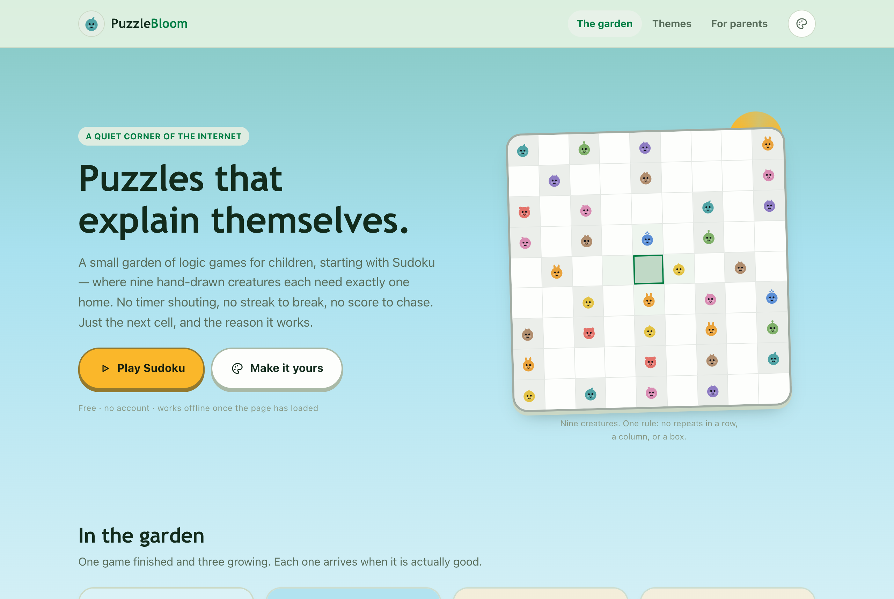
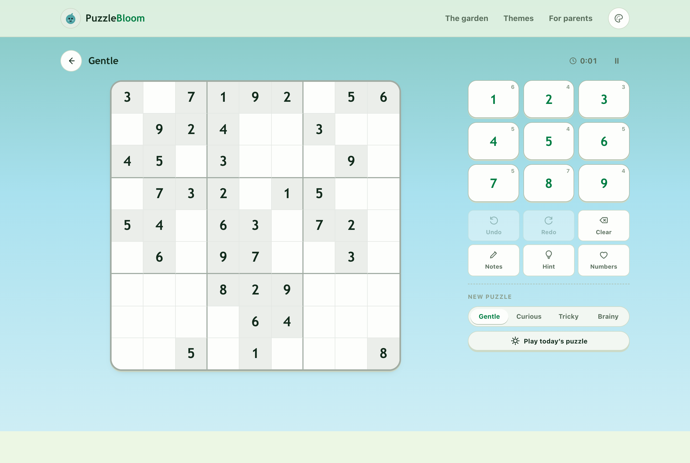
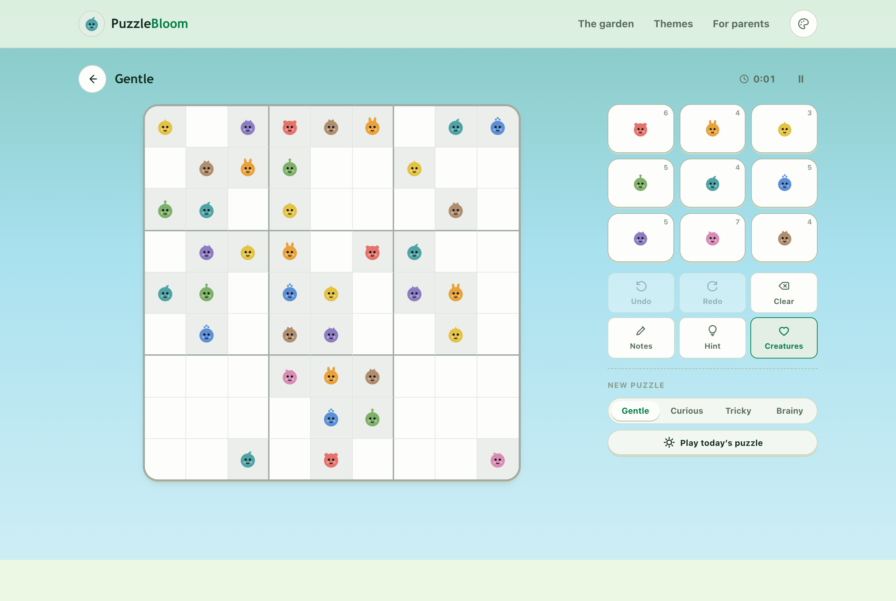
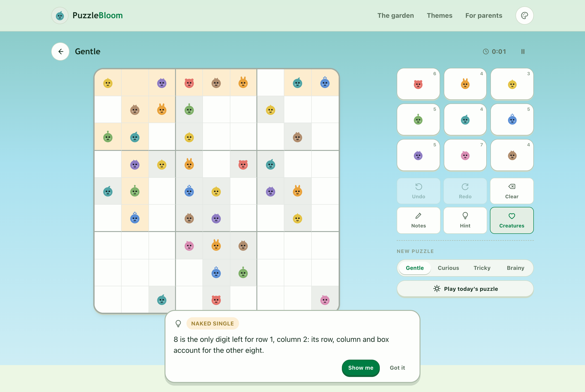
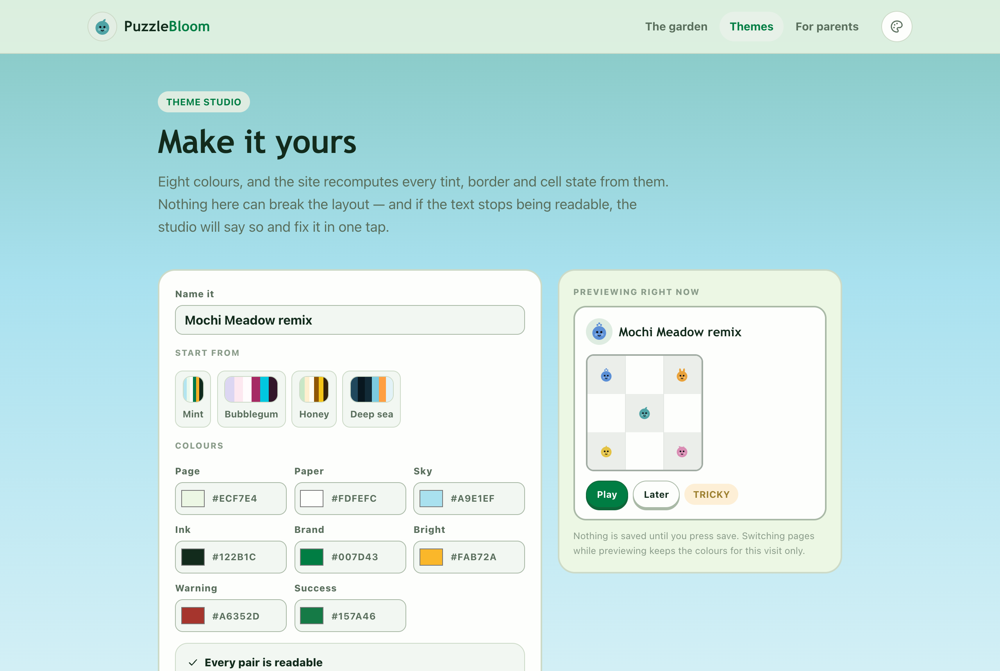

# PuzzleBloom

A small garden of calm puzzle games for children — starting with Sudoku.

Every game here is static files. No accounts, no ads, no chat, no server, no
telemetry. Puzzles are generated on the device the child is holding and never
leave it. The product goal is narrow and deliberate: **be a place where the
answer to "can I play something?" is simply yes.**



---

## Why this exists

Most games built for children are built to be returned to — a streak to protect,
a chest to open, a friend's score to beat. Those mechanics work, which is the
problem: they teach a child to keep playing rather than to finish.

A puzzle has the opposite shape. It ends, it is satisfying at the moment it is
solved, and then there is nothing left to collect. Everything in this repo
follows from that.

The other half is art direction. Cartoon creatures are not decoration here —
they are the accessibility feature. Nine numerals are nine abstract squiggles to
a five-year-old; nine faces with their own ears and horns are nine *characters*.
The same board can be played with either.

| Numerals | Creatures | Hints that explain |
| --- | --- | --- |
|  |  |  |

---

## What is in the box

```
puzzlebloom/
├─ apps/web/                  the site: router, pages, theme provider, styles
├─ games/sudoku/              the first game (React)
├─ packages/
│  ├─ sudoku-engine/          generator, solver, logical grading, teaching hints
│  ├─ theme-core/             theme model, built-in moods, contrast guard, share links
│  └─ ui/                     locked icon set, buttons, segmented control, creature glyphs
├─ docs/                      spec, ADRs, screenshots
└─ vercel.json                deploy config (Cloudflare Pages works too)
```

pnpm workspaces. No bundler plugins beyond React, no CSS framework, no state
library, no router dependency — the router is 90 lines in
`apps/web/src/app/router.tsx`.

## Quick start

```bash
pnpm install
pnpm dev          # http://localhost:5173
pnpm typecheck    # tsc --noEmit across the app and the packages
pnpm test         # 189 engine tests + 42 palette guards
pnpm build        # static bundle in apps/web/dist
```

Node 20+.

## How it is put together

**The engine is the only thing worth trusting.** `packages/sudoku-engine` is a
port of [HeyPuter/everything's Sudoku](https://github.com/HeyPuter/everything/tree/main/src/sudoku)
(MIT — see [THIRD_PARTY_NOTICES.md](THIRD_PARTY_NOTICES.md)), kept verbatim
except for types. It guarantees two things the UI leans on:

- every puzzle has **exactly one** solution;
- every puzzle is solvable by **logic alone**, using the eleven techniques in
  `techniques.js` — which is why the hint button always has something true to
  say, and never has to read the answer key.

Generation runs in a Web Worker; Expert grids take a few hundred milliseconds
and would otherwise freeze the tab.

**Themes are ten colours and nothing else.** Every tint, border and cell state
is a `color-mix()` of those ten, computed in CSS. That is why a theme a child
makes in the studio still looks designed rather than assembled — and why adding
a mood costs twelve lines.

Three of the ten exist because one colour cannot do three jobs:

| role | job | constraint |
| --- | --- | --- |
| `brand` | links, focus rings, the selected cell | 4.5:1 as text, so its chroma is capped |
| `accent` | the loud colour: primary button, sun, bands | allowed to own ~26% of the screen |
| `sky` | the wide decorative wash behind everything | no text on it, so its chroma is uncapped |

`accentInk` is the fourth and the one that unlocks the rest: a bright fill can
only carry a label if the label is allowed to be dark, and that pairing is
measured (9.7:1 on Meadow) rather than guessed. `deriveAccentInk()` computes it,
so the studio never asks a child to pick it.

The reasoning, the measurements and what is still unbuilt are in
[DESIGN-REVIEW-v0.2.md](docs/DESIGN-REVIEW-v0.2.md).



Themes are stored in `localStorage` and can be shared as a link: the whole
palette is packed into `?theme=` as base64url, validated on arrival. No backend.

**Dark moods get their own cell tints.** Mixing 7% white into a dark surface is
invisible, so `:root[data-mood='dark']` raises the fill. See
[tokens.css](packages/theme-core/src/tokens.css).

## Accessibility

- Full keyboard play: arrows move, `1–9` place, `Backspace` clears, `N` notes,
  `H` hint, `⌘/Ctrl+Z` undo.
- Every cell announces its row, column and contents; the board is a real
  `role="grid"` of buttons.
- The theme studio measures WCAG contrast for eight pairs and offers a one-tap
  repair instead of letting pale text through.
- Motion is never the only signal: a finished row also changes the cells, a
  wrong digit is announced by `aria-live`, and everything above collapses under
  `prefers-reduced-motion`.
- Creatures carry their identity in silhouette, not only in colour, so they
  survive colour blindness and greyscale.
- Route changes and theme changes use the View Transitions API, gated on
  `prefers-reduced-motion`.

## Adding a game

1. Create `games/<id>/` with a package that exports a manifest and a component.
2. Add the manifest to `apps/web/src/games/registry.ts`.
3. Add one route in `apps/web/src/App.tsx` (lazy import).

The landing page, the "growing" shelf and styling all follow automatically.
Keep the game's manifest out of the package index if the game is heavy — that
mistake pulls the whole game into the first paint (there is a comment about it
in `registry.ts`).

## Deploying

**Vercel** — import the repo. `vercel.json` already sets the build command
(`pnpm run build`), the output directory (`apps/web/dist`), SPA rewrites, cache
headers and a CSP. Nothing else to configure.

**Cloudflare Pages** — build command `pnpm run build`, output directory
`apps/web/dist`. `public/_redirects` and `public/_headers` are picked up
automatically.

The build is fully static: any host that serves files works.

## Status

| | |
| --- | --- |
| Sudoku | shipped — 4 levels, daily puzzle, hints that explain, creatures mode |
| Nonogram | in the greenhouse |
| Memory Garden | in the greenhouse |
| Tangram | in the greenhouse |

## Licence

MIT. The Sudoku engine is MIT, copyright the HeyPuter/everything contributors;
that attribution lives in [THIRD_PARTY_NOTICES.md](THIRD_PARTY_NOTICES.md) and
must stay if you fork this.

Built by a parent, for one small person and everyone like her.
